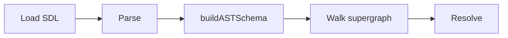
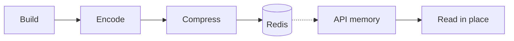
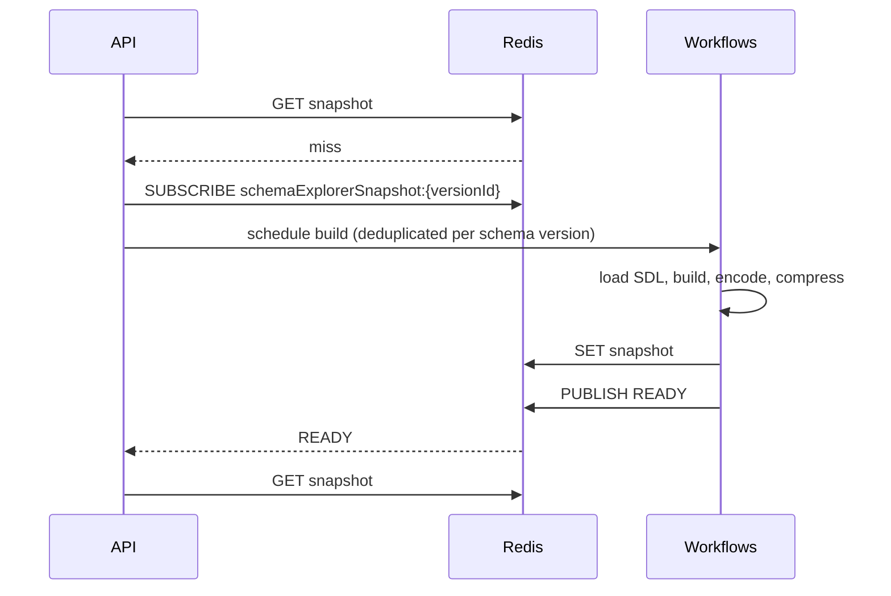
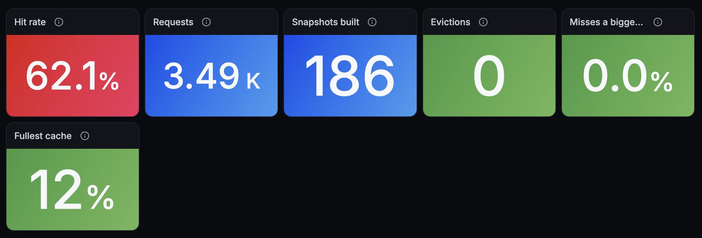
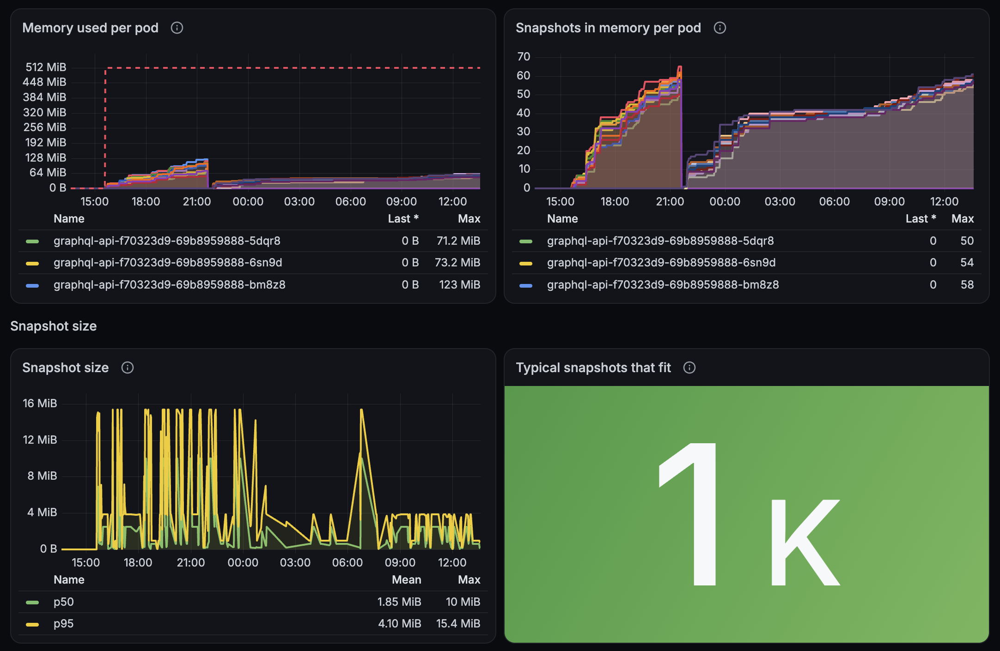

import { Callout } from "@hive/design-system/hive-components/callout";

As we are building Hive Console, our GraphQL schema registry, our users keep publishing bigger and
bigger schemas. A federated supergraph with a few hundred subgraphs and tens of thousands of types
is no longer an exception.

The bigger a schema gets, the harder it becomes to understand it, and the more important the tools
are that help you do so. In Hive Console, a few features are built exactly for that:

- **Schema explorer:** browse every type and field of a schema version, see how often each one is
  used and, for federated projects, which subgraph owns it. It is the place to answer "what does our
  graph actually look like?" without digging through dozens of subgraph repositories.
- **Unused schema:** shows the parts of the schema that no client has requested within a given
  period. This is what teams use to find fields that can be removed safely, and keep a growing schema
  from turning into a graveyard.
- **Deprecated schema:** lists everything that is deprecated, together with its usage, so teams can
  see whether clients have migrated away from a field before removing it.
- **Schema coordinate insights:** for a single type or field, shows which clients and operations use
  it and which subgraphs own it. It answers "who will I break if I change this?" and "which team do
  I need to talk to?".

These are the pages people open while planning a breaking change, cleaning up their schema, or
investigating an incident. If they take seconds to load (or time out) for the largest schemas,
people simply stop using them, exactly where they would help the most.

And that is what happened. Users with large federated graphs complained to us about the long loading
times of these pages.

In this post we will talk about how these pages of Hive Console went from taking seconds and
hundreds of megabytes of memory per request to a few milliseconds, by turning every schema version
into a single binary buffer that we read in place.

## The Problem

All of these pages need information about the schema of a specific schema version: the types, their
fields, arguments, descriptions, deprecation reasons, and for federated projects which subgraphs
own a type or field.

Until now, every single GraphQL request for one of these pages did the following, regardless of how
much of the schema it actually returned:

1. Load the composite SDL and the supergraph SDL of the schema version from PostgreSQL.
2. Parse both of them into a GraphQL AST.
3. Build a `GraphQLSchema` via `buildASTSchema`.
4. Walk the supergraph and extract the subgraph ownership from the `@join__*` directives.
5. Transform the requested types into what our resolvers return.

The unused and deprecated schema additionally filtered the composite SDL's AST with dedicated
visitors, and the insights page parsed and walked the supergraph again for every requested schema
coordinate.

For small schemas this is not noticeable. For a 20 MB supergraph, it looks like this:

- A single request takes 1–2 seconds, up to 3.6 seconds for the explorer page (which sends two
  operations).
- A single request holds between 130 MB and 680 MB of JavaScript heap while it runs.
- All of it is synchronous. The Node.js event loop is blocked for the whole duration, so every other
  request on the same API instance has to wait.

Ten users opening the explorer of a big schema at the same time could make an API instance hold
almost 7 GB of memory. On top of that, the garbage collector has to deal with all of these objects,
and a full GC pause went from 9 ms to up to 172 ms while such a request was alive.

The interesting part is that all of this work is pointless. **A schema version never changes after
it has been published.** Everything we derive from it could be computed once and reused by every
request and every API instance.

So far, every request walked through the full pipeline:



What we wanted instead is to do the expensive part once per schema version, keep the result in
Redis, and have each API instance load it into memory once and read from it for every request:



## What we tried first

Before ending up with a custom binary format, we looked at a few more obvious approaches, and
actually built one of them.

### Caching the `GraphQLSchema` in memory

The first idea would be to keep the built `GraphQLSchema` object in memory, e.g. in an LRU cache.

However, that solves only half of the problem. A `GraphQLSchema` of a 20 MB supergraph consists of
millions of small JavaScript objects. Keeping a few of them around means the garbage collector has
to walk all of them on every full GC, forever. And every API instance would still have to parse and
build the schema on its own, at least once per schema version, blocking its event loop.

We also can not serialize a `GraphQLSchema` and share it between instances, without parsing it
again on the other side.

### Ingesting the schema into a database

The second idea was to break every schema version down into rows and store them in a database we
already run, such as PostgreSQL or ClickHouse. One row per schema coordinate, with its type,
description, deprecation reason and owning subgraphs. The explorer pages would then become
(hopefully) simple queries.

The more we thought about it, the less appealing it got.

**Every publish becomes a bulk insert.** Our benchmark schemas have between 125k and 389k schema
coordinates. Some projects publish new schema versions many times a day from their CI pipelines. We
would have to insert hundreds of thousands of rows for every single schema version, even though most
of them are never opened in the explorer at all.

**There is no good clean-up story.** Schema versions are immutable, but they do not stop being
relevant. People still occasionally want to look at an older version, e.g. while investigating an
incident or comparing changes. So we can not simply delete the rows of a schema version once a newer
one is published. Keeping them forever means the tables grow with every publish. Deleting them
after some time means we need a way to rebuild them on demand anyway, at which point the database is
just a very expensive cache. On top of that, deleting large amounts of rows is not something either
PostgreSQL (table bloat, vacuum) or ClickHouse (heavy mutations) enjoys.

**The source of truth already exists.** The composite SDL and the supergraph of every schema version
are already stored. Anything we derive from them can be thrown away and recomputed at any time, so
it should be treated like a cache, not like data we have to manage.

### A flat JSON snapshot

Our first actual implementation took the cache idea, but with a format that can be shared between
instances. We walked the schema and the supergraph once per schema version and wrote down
everything the explorer pages need as plain JSON, keyed by schema coordinate.

```json title="The first snapshot format (simplified)"
{
  "coordinates": {
    "Query": { "kind": "ObjectTypeDefinition", "fields": ["Query.user", "Query.posts"] },
    "Query.user": {
      "kind": "FieldDefinition",
      "type": "User",
      "args": ["Query.user.id"],
      "ownedBy": ["users"]
    },
    "Query.user.id": { "kind": "InputValueDefinition", "type": "ID!" },
    "User.name": {
      "kind": "FieldDefinition",
      "type": "String",
      "args": [],
      "deprecationReason": "Use fullName.",
      "ownedBy": ["users"]
    }
  },
  "types": ["Post", "Query", "Role", "User"],
  "deprecatedTypes": ["User"],
  "subgraphNames": ["posts", "users"]
}
```

The snapshot was stored in Redis and in an in-memory cache on each API instance. This already got
rid of parsing the SDL and running `buildASTSchema` on every request, and it made the unused and
deprecated schema a lot simpler.

However, it moved the problem rather than solving it.

- **JSON has to be parsed as a whole.** Before a request can read a single type, the full document
  has to go through `JSON.parse`. For our benchmark schemas that is hundreds of thousands of
  coordinate entries, parsed synchronously on the event loop, on every instance that loads it.
- **The parsed snapshot is a huge object graph.** Keeping it in memory means the garbage collector
  has to walk hundreds of thousands of objects, arrays and strings on every full GC. Exactly what we
  wanted to avoid with the `GraphQLSchema`.
- **Lots of repetition.** Every coordinate repeats its full name in the keys and in the child lists,
  every field repeats its `ownedBy` array, and type references such as `[Post!]!` are strings that
  have to be parsed again when they are read.

### What we actually needed

So we needed a representation that:

- can be built once and shared across all API instances,
- can be read without being parsed or deserialized first,
- adds (almost) nothing to the JavaScript heap and the garbage collector while it is cached,
- only decodes the parts of the schema a request actually needs,
- is only built for schema versions someone actually looks at, and can be evicted and rebuilt at any
  time.

## The Solution: a flat, binary schema snapshot

We ended up with a snapshot format that is a single `Buffer`, laid out as a struct-of-arrays.
Instead of an object per type or field, each entity kind (types, fields, input values and enum
values) is a set of parallel typed-array columns. References between entities are just row indexes.

```ts title="Part of the column definitions (simplified)"
const COLUMNS = [
  // types (in name order)
  ["typeName", Int32Array, "typeCount"],
  ["typeDescription", Int32Array, "typeCount"],
  ["typeOwnerSet", Int32Array, "typeCount"],
  ["typeChildrenStart", Uint32Array, "typeCount"], // into fields, input values or enum values
  ["typeChildrenLength", Uint32Array, "typeCount"],
  ["typeKind", Uint8Array, "typeCount"],
  ["typeFlags", Uint8Array, "typeCount"],
  // fields of object and interface types
  ["fieldName", Int32Array, "fieldCount"],
  ["fieldDescription", Int32Array, "fieldCount"],
  ["fieldDeprecationReason", Int32Array, "fieldCount"],
  ["fieldOwnerSet", Int32Array, "fieldCount"],
  ["fieldType", Uint32Array, "fieldCount"],
  ["fieldArgsStart", Uint32Array, "fieldCount"], // into input values
  ["fieldArgsLength", Uint32Array, "fieldCount"],
  ["fieldParentType", Uint32Array, "fieldCount"],
  ["fieldTypeWrapping", Uint16Array, "fieldCount"],
  // ...
];
```

The buffer starts with a few magic bytes and a format version, followed by the lengths of all
columns. Every column is 8-byte aligned, so opening a snapshot is nothing more than creating a typed
array view for each column on top of the same buffer. No copying, no parsing.

The fields of a type and the arguments of a field are stored as contiguous row ranges. Looking up the
fields of a type means reading `typeChildrenStart` and `typeChildrenLength` and iterating over that
range of the field columns.

To give you an idea, this is how the following two subgraphs end up in the field columns.

```graphql title="users subgraph"
type Query {
  user(id: ID!): User
}

type User @key(fields: "id") {
  id: ID!
  name: String @deprecated(reason: "Use fullName.")
  fullName: String
  role: Role
}

enum Role {
  ADMIN
  USER
}
```

```graphql title="posts subgraph"
type Query {
  posts(first: Int = 10): [Post!]!
}

type Post @key(fields: "id") {
  id: ID!
  title: String
  author: User
}

type User @key(fields: "id") {
  id: ID!
  posts: [Post!]!
}
```

| #   | parent type | name       | type     | wrap | args | owners       | deprecation      |
| --- | ----------- | ---------- | -------- | ---- | ---- | ------------ | ---------------- |
| 0   | `Post`      | `id`       | `ID`     | 8    | –    | posts        | –                |
| 1   | `Post`      | `title`    | `String` | 0    | –    | posts        | –                |
| 2   | `Post`      | `author`   | `User`   | 0    | –    | posts        | –                |
| 3   | `Query`     | `posts`    | `Post`   | 25   | 0…0  | posts        | –                |
| 4   | `Query`     | `user`     | `User`   | 0    | 1…1  | users        | –                |
| 5   | `User`      | `id`       | `ID`     | 8    | –    | posts, users | –                |
| 6   | `User`      | `posts`    | `Post`   | 25   | –    | posts        | –                |
| 7   | `User`      | `name`     | `String` | 0    | –    | users        | `"Use fullName."`|
| 8   | `User`      | `fullName` | `String` | 0    | –    | users        | –                |
| 9   | `User`      | `role`     | `Role`   | 0    | –    | users        | –                |

In the buffer, every one of these cells is just a number. Let's look at the tricks that make that
possible.

### Strings are stored once

Every string (type names, field names, descriptions, ...) is deduplicated and referenced by an id.

This matters more than you might expect. Our first benchmark schema is generated from the
[schema.org](https://schema.org) vocabulary, which repeats the description of a property on every
type that has the property. 13 MB of descriptions in the SDL become 9,285 distinct strings that take
0.6 MB. The 7,734 distinct names only take 0.12 MB.

The same goes for subgraph ownership. Instead of storing a list of subgraph names per field, each
distinct list of subgraphs (an "owner set") is stored once and referenced by id. The whole schema.org
supergraph with 20 subgraphs has only 50 different owner sets.

### Types are numbers

A type reference like `[Post!]!` is not stored as a string. It is stored as the id of the type `Post`
plus a few wrapping bits: the list depth in the lower three bits, and a mask of which levels are
non-null above that.

```ts title="Formatting a type reference from its wrapping bits"
function formatTypeRef(name: string, wrapping: number) {
  const listDepth = wrapping & 7;
  const nonNullMask = wrapping >> 3;
  let out = "[".repeat(listDepth) + name;
  if (nonNullMask & (1 << listDepth)) {
    out += "!";
  }
  for (let level = listDepth - 1; level >= 0; level--) {
    out += "]";
    if (nonNullMask & (1 << level)) {
      out += "!";
    }
  }
  return out;
}
```

`[Post!]!` has a list depth of `1`, and both the outer list (level `0`) and the inner type (level
`1`) are non-null, so the mask is `0b11` and the wrapping is `1 | (0b11 << 3) = 25`. `ID!` is
`0 | (0b1 << 3) = 8`. Those are the `25` and `8` you saw in the table above.

### Looking up a schema coordinate without allocating

The insights page and the unused schema need to find a specific
[schema coordinate](https://spec.graphql.org/draft/#sec-Schema-Coordinates) such as `User.posts` or
`Query.user.id`. For this the snapshot contains an open-addressing hash table, using FNV-1a and
linear probing, that maps a coordinate to a "handle" (the entity kind plus its row index).

```ts title="FNV-1a and open addressing over an Int32Array"
/** FNV-1a over UTF-16 code units of `value[start, end)`. */
function fnv1a(value: string, start: number, end: number) {
  let hash = 0x811c9dc5;
  for (let index = start; index < end; index++) {
    hash = Math.imul(hash ^ value.charCodeAt(index), 0x01000193);
  }
  return hash >>> 0;
}

/** The first value in the probe sequence of `hash` for which `matches` is true, or NONE. */
function hashTableFind(
  table: Int32Array,
  hash: number,
  matches: (value: number) => boolean,
): number {
  const slotMask = table.length - 1;
  for (let slot = hash & slotMask; ; slot = (slot + 1) & slotMask) {
    const value = table[slot];
    if (value === NONE || matches(value)) {
      return value;
    }
  }
}
```

The coordinates themselves are not stored in the buffer. When a slot is hit, we verify the match by
comparing the segments of the requested coordinate (`User`, `posts`) against the stored names of the
type row and the field row, character by character. No string is built, no object is allocated.

For the insights page, "which subgraphs own `Query.user`?" went from parsing and walking a 20 MB
supergraph to a single hash table lookup and reading one owner set.

### Descriptions are decoded only when read

Names are looked up by their value (e.g. for the hash table verification above), so we decode all
of them into a single JavaScript string when a snapshot is opened.

Descriptions, deprecation reasons and default values, on the other hand, are only ever read. They
make up most of the text of a schema, so we store them in a separate UTF-8 region as "lazy strings".
Each one is decoded on its first read (about 70 ns) and then kept, so every later read is an array
lookup (about 5 ns).

This had a nice side effect we did not anticipate. V8 stores a string with two bytes per character
as soon as a single character is outside of Latin-1. Before we split the strings, a single "→" in
any description doubled the memory of all decoded text, including all names. Names are ASCII, so
they now always stay at one byte per character.

For schema.org, opening a snapshot now decodes 127k characters instead of 758k, and a freshly opened
snapshot is about 20% smaller.

### What a request actually touches

With this layout, every feature only reads the parts of the buffer it needs:

| Feature           | Reads                                                                  | Never touches                       |
| ----------------- | ---------------------------------------------------------------------- | ----------------------------------- |
| Type filter       | Type names, kinds and owner sets                                       | Fields, arguments, descriptions     |
| Type page         | One type row, its contiguous range of fields and their lazy strings    | Every other type                    |
| Unused schema     | Usage marked through the hash table, then only types with unused parts | Types that are fully used           |
| Deprecated schema | A precomputed list of types that contain something deprecated          | Every type without deprecations     |
| Insights page     | One hash table lookup and one owner set                                | Everything else                     |

The resolvers materialize objects on demand from the snapshot. E.g. for the type filter of the
explorer, `types` returns lazy entities where the name and kind come straight from the columns, and
the rest is only decoded if the GraphQL operation selects it.

For the unused schema, we either mark the used coordinates through the hash table, or check every
schema coordinate against the set of used ones, whichever touches fewer entries. Then only the types
that have something unused are materialized.

## Caching the snapshots

Since a schema version is immutable, a snapshot never has to be invalidated. We cache it on two
levels.

**Redis.** The encoded buffer is compressed with zstd and stored under a key that contains the
format version and the schema version id. zstd shrinks the buffer about 6x: the schema.org snapshot
goes from 5.8 MB to 0.97 MB, compared to 21.3 MB of supergraph SDL. The TTL only exists to bound the
Redis memory.

**API memory.** Each API instance keeps an LRU of opened snapshots, bounded by their estimated
memory. The buffers live outside the JavaScript heap, and an opened snapshot is only a handful of
objects, so a cached snapshot causes no measurable change in GC pauses. The first request of an
instance fetches and decompresses the snapshot from Redis (2–10 ms, using the asynchronous zlib
API, so it runs on the libuv thread pool and not on the event loop).

Concurrent requests for the same schema version on the same instance share a single load.

<Callout type="info">
  Because the format version is part of both the Redis key and the first bytes
  of the buffer, we can change the format without any migration. Unknown,
  truncated or corrupt buffers are rejected and simply rebuilt.
</Callout>

## Getting the build off the event loop

With the first iteration shipped, every request was fast as long as the snapshot already existed.
However, the first request for a schema version still had to build it. For a large schema, building
a snapshot takes 1.5 to 3.4 seconds of CPU time, and the Hive Console API did that on its main
thread. Which means we were back to blocking the event loop, just less often.

So in the follow-up, we moved the build into the Hive Console `workflows` service, which is already
responsible for running background tasks. The API now only ever reads finished snapshots.



The build task is deduplicated per schema version, so concurrent requests from all API instances
share a single build. Each waiting request subscribes to a pub/sub channel for that schema version
and is notified once the build finished with `READY`, `EMPTY` (the version has no schema) or
`ERROR`.

There are a few details that are easy to get wrong here:

- **Subscribe before scheduling.** If the build is fast, the notification could be published before
  the API starts listening. So we subscribe first, then check Redis once more (another instance
  might have stored the snapshot in the meantime), and only then schedule the task.
- **Do not rely on pub/sub alone.** Pub/sub messages can be missed, so as a fallback the API checks
  every five seconds whether the snapshot was stored in Redis.
- **Do not wait forever.** A request waits at most 15 seconds and then fails with a hint to try again. The build
  itself carries on, so the retry will most likely find the snapshot.

To share the code between the API and the workflows service, the snapshot builder, the binary
encoding and the Redis store now live in their own internal package.

As a bonus, since the API no longer needs the SDL for any of these pages, it also stopped loading
the (potentially huge) composite and supergraph SDL from PostgreSQL unless a GraphQL operation
actually selects `sdl` or `supergraph`.

## Keeping an eye on it

A cache that is too small quietly turns back into the slow path we just removed. Every schema
version that is evicted from memory and requested again has to be loaded from Redis, or even rebuilt.
So we did not want to guess the cache size, we wanted to see whether it is right.

That is why we built observability into the cache and the snapshot builds from the start. Every
request records where its snapshot came from (memory, a load already in progress, Redis, or a fresh
build), and the cache reports its memory usage, evictions and the size of the snapshots it stores.
All of this ends up in a dedicated Grafana dashboard.



The panels at the top are the ones we look at first:

- **Hit rate:** the share of requests served from memory or by joining a load that is already in
  progress.
- **Snapshots built:** how often a snapshot was neither in memory nor in Redis and had to be built
  by the workflows service.
- **Evictions:** snapshots dropped from memory to stay within the size limit.
- **Misses a bigger cache avoids:** the share of misses for schema versions that the same instance
  evicted within the hour before. This is the one that tells us whether the cache is too small.
- **Fullest cache:** the memory used by the fullest instance's cache, relative to its limit.

A hit rate of 62% might look low at first, but the other panels tell the full story. There are no
evictions, no misses a bigger cache would have avoided, and the fullest cache is at 12% of its
limit. The misses come from schema versions that an instance sees for the first time, not from a
cache that is too small. Making the cache bigger would not change anything here.

If that changes, e.g. because more customers with very large supergraphs start using these pages,
the dashboard will show it as evictions and misses after eviction, and we can raise the limit

Further down, the dashboard also breaks down the miss cost (Redis loads vs. builds), the age of
evicted snapshots, the memory and snapshot count per API pod, the snapshot sizes, and the queue time
and duration of the builds in the workflows service.



These panels show the cache over about a day. Each API pod holds up to around 60 schema versions in
memory, using at most 123 MiB of its 512 MiB limit. The drop to zero in the evening is a deployment:
new pods start with an empty memory cache and fill it again from Redis as schema versions are
requested, instead of building every snapshot again.

The snapshot sizes are also reassuring. The median snapshot is about 1.9 MiB and the 95th percentile
about 4.1 MiB, with the largest at 15.4 MiB. With the current limit, roughly a thousand typical
schema versions fit into the memory of a single pod.

The dashboard is part of the Hive Console repository, so if you are self-hosting, you can use it to
tune the cache for your own schemas as well.

## The Results

We measured everything on two supergraphs of about 20 MB each:

- **schema.org:** generated from the schema.org vocabulary. 125k schema coordinates, real
  descriptions, interfaces, unions, enums, input types, deprecations and 20 subgraphs.
- **Synthetic:** 389k schema coordinates and 20k types.

| Request                                | schema.org: before → after | Faster    | Synthetic: before → after | Faster    |
| -------------------------------------- | -------------------------- | --------- | ------------------------- | --------- |
| Explorer page (page query + filter)    | 1.86 s → 8.7 ms            | ~210x     | 3.60 s → 33 ms            | ~110x     |
| Type page                              | 1.74 s → 3.8 ms            | ~460x     | 3.46 s → 32 ms            | ~110x     |
| Unused schema, 90% of types fully used | 0.96 s → 37 ms             | ~26x      | 2.02 s → 130 ms           | ~16x      |
| Unused schema, random 50% used         | 0.98 s → 78 ms             | ~13x      | 1.99 s → 250 ms           | ~8x       |
| Deprecated schema                      | 0.96 s → 23 ms             | ~42x      | 2.03 s → 47 ms            | ~44x      |
| Insights: owners of one coordinate     | 0.48 s → < 0.1 ms          | > 1,000x  | 0.98 s → < 0.1 ms         | > 1,000x  |

| Memory                                    | schema.org     | Synthetic      |
| ----------------------------------------- | -------------- | -------------- |
| Heap held by one explorer request, before | 248 MB         | 683 MB         |
| Heap held by one explorer request, after  | 2.4 MB         | 19.7 MB        |
| Snapshot per cached version (off-heap)    | 6.0 MB         | 20.3 MB        |
| Snapshot in Redis (zstd)                  | 1.0 MB         | 3.9 MB         |

<Callout type="info">
  The numbers were measured on a single machine, as medians of 3–7 runs, with
  the snapshot already in memory. The "before" numbers exclude loading the SDL
  from PostgreSQL. ClickHouse queries and GraphQL execution are the same on both
  sides and are excluded too.
</Callout>

## What we take on

Of course, this does not come for free.

- **About 1,500 lines of low-level typed-array code.** This is not the kind of code you usually write
  in a GraphQL API. To stay confident, our tests check that every schema coordinate reads back
  exactly as the builder produced it, including edge cases such as emoji, a leading `U+FEFF` and lone
  surrogates. Before switching over, we compared the new reader against the old implementation
  without finding a difference. We also added integration tests for
  all affected features _before_ touching any of the code, with snapshots taken from the old
  implementation.
- **A build per schema version.** That is a few seconds of CPU time, but it now happens in the
  workflows service, once, and not on the request path of the API.

## Conclusion

The biggest win in this project did not come from optimizing the parser or the GraphQL schema
building. It came from realizing that the data never changes, and then picking a representation
that fits how it is read, instead of how it is written.

Struct-of-arrays layouts, string interning and open-addressing hash tables are not new ideas, but
they are not something you reach for often in a Node.js service. For large, immutable and
read-heavy data, they work great in JavaScript too, thanks to typed arrays and buffers living
outside the JavaScript heap.

This project also changed how we think about GraphQL tooling in JavaScript in general. Validating
and executing an operation constantly looks up types, fields and arguments on a `GraphQLSchema`,
which consists of millions of small JavaScript objects for a large schema. That is the same overhead
we just got rid of in the Hive Console schema explorer.

We believe that a flat, low-level representation of the schema (and possibly of documents) could
make things like validation and execution in graphql.js significantly faster and lighter on memory.
This is something we might want to explore in the future, and we are already actively applying these
ideas in [Hive Router](/docs/router).

With the schema now served from the snapshot in a few milliseconds, the biggest bottleneck of these
pages has moved. Most of the remaining time is spent loading the usage and analytics data from
ClickHouse, which we are going to improve soon as well.

The schema explorer is only one part of this story. Our existing customers keep growing their
federation setups, and we are onboarding new users with very large supergraphs, which puts the rest
of the Hive Console API under the same kind of pressure. We are actively exploring further ways to
improve its performance and throughput, and will write about those as well once they land, so stay
tuned!

In case you did not know, Hive Console is fully open-source and self-hostable! You can find all the
code and pull requests on GitHub:

- https://github.com/graphql-hive/console/pull/8987
- https://github.com/graphql-hive/console/pull/9001
