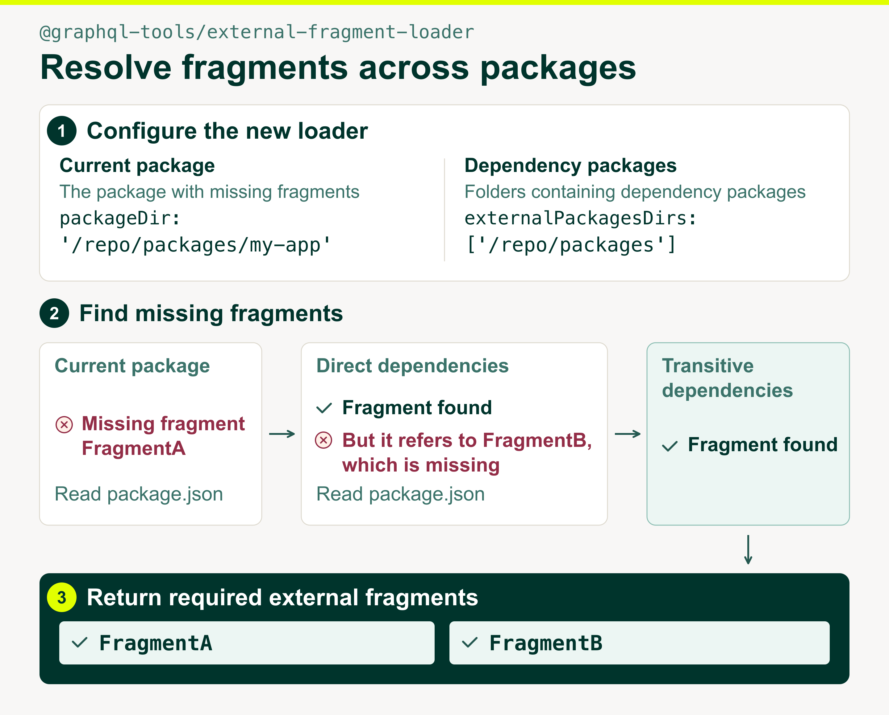

We're excited to introduce
[`@graphql-tools/external-fragment-loader`](https://www.npmjs.com/package/@graphql-tools/external-fragment-loader),
a new package in [GraphQL Tools](https://the-guild.dev/graphql/tools) that makes sharing GraphQL
fragments across packages easier!

The loader resolves missing GraphQL fragments by following direct and transitive dependencies in
`package.json`. It loads the external fragments your package needs.

## Why we built it

At [Yelp](https://www.yelp.com/), we have a large monorepo where GraphQL fragments are shared across
packages. Although we try to
[avoid reusing fragments directly](https://graphql.org/conf/2025/schedule/95c83506420d9a9a3a971a8802ba96f8/),
they still need to be imported and spread into page-level operations. An operation in one package
can use a fragment from a dependency listed in `package.json`. That fragment can, in turn, use
fragments from other dependencies.

Previously, we had to manually maintain a list of files containing these external fragments, both to
assemble complete GraphQL operations for execution and to run GraphQL Code Generator. Adding a
fragment dependency meant updating the list with its file and the files containing any fragments it
referenced transitively. As packages evolved, keeping the list up to date became tedious.

For example, a package might use a fragment named `FragmentA` from a shared package. Its file must
be added manually to the consuming package's list. If `FragmentA` starts referencing `FragmentB`
from another package, the list must include that fragment's file too, even though the consuming
package's own operation hasn't changed.

Here is an example of a manually maintained list:

```yml
project:
  package-a:
    external-fragment-files:
      - path/to/file/with/FragmentA.ts
      - path/to/file/with/FragmentB.ts
```

## Loading fragments from package dependencies automatically

The external fragment loader resolves missing GraphQL fragments by following direct and transitive
dependencies in `package.json`. It loads only the external fragments the package needs. In the
example above, it finds both `FragmentA` and `FragmentB` automatically.



Here is an example configuration for GraphQL Code Generator using the new loader, assuming Codegen
runs from the monorepo root:

```ts filename="codegen.ts"
import { resolve } from 'node:path'
import type { CodegenConfig } from '@graphql-codegen/cli'

const packageDir = resolve('packages/my-app')

const config: CodegenConfig = {
  schema: './schema.graphql',
  documents: ['./packages/my-app/src/**/*.graphql'],
  externalDocuments: [
    {
      [packageDir]: {
        loader: '@graphql-tools/external-fragment-loader',
        packageDir,
        externalPackagesDirs: [resolve('packages')],
        async: true
      }
    }
  ],
  generates: {
    './packages/my-app/src/__generated__/types.ts': {
      plugins: ['typescript', 'typescript-operations']
    }
  }
}

export default config
```

With this setup, the loader uses the dependencies declared in `package.json` to find the required
external fragments as they change, without requiring a manually maintained list of files.

See the new
[loader documentation](https://github.com/ardatan/graphql-tools/tree/master/packages/loaders/external-fragment)
for more configuration options.

## What's next

We originally built this loader to resolve fragment dependencies before executing GraphQL operations
and to support [GraphQL Code Generator](https://github.com/dotansimha/graphql-code-generator). Now
we're exploring integrations with [GraphQL ESLint](https://github.com/graphql-hive/graphql-eslint)
and
[Apollo's persisted query manifest generator](https://github.com/apollographql/apollo-utils/tree/main/packages/generate-persisted-query-manifest)
to bring the same fragment resolution to more GraphQL workflows.
