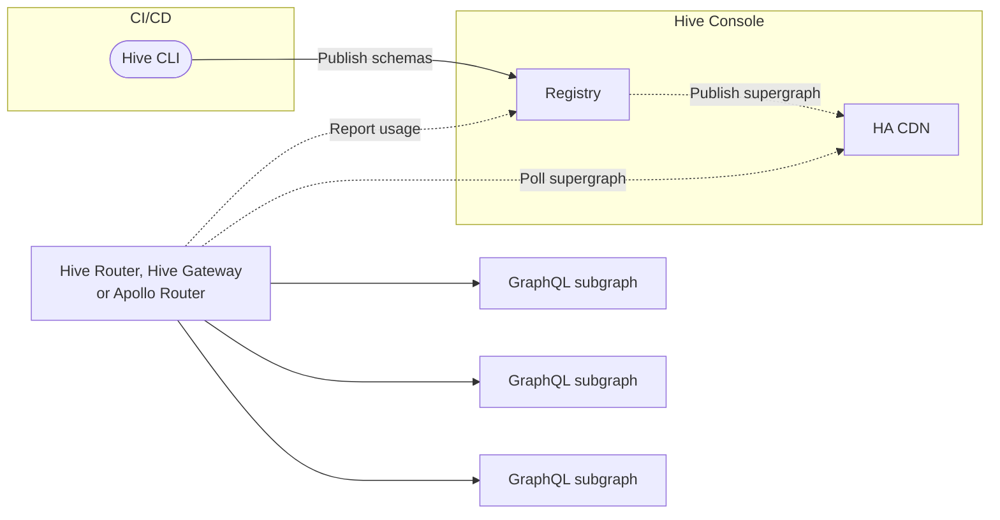

import { Callout } from "@hive/design-system/hive-components/callout";

Hive is an **open-source alternative to Apollo GraphOS** (formerly Apollo Studio). It gives you a
schema registry, schema checks, usage insights, a Federation router and a gateway, and every part of
it is MIT licensed, including the registry itself. You can use the hosted
[Hive Cloud](https://app.graphql-hive.com) or
[run the same software yourself](/docs/schema-registry/self-hosting/get-started).

This page shows which part of Hive replaces which part of GraphOS, and how to move over one piece at
a time.

## What Maps to What

| In Apollo GraphOS                       | In Hive                                                                                                                                                   |
| --------------------------------------- | --------------------------------------------------------------------------------------------------------------------------------------------------------- |
| GraphOS Studio                          | [Hive Console](/docs/schema-registry), hosted or [self-hosted](/docs/schema-registry/self-hosting/get-started)                                            |
| Rover CLI                               | [Hive CLI](/docs/api-reference/cli)                                                                                                                       |
| Graphs and variants                     | [Projects](/docs/schema-registry/management/projects) and [targets](/docs/schema-registry/management/targets)                                             |
| Managed federation and Uplink           | Composition in the registry and the [high-availability CDN](/docs/schema-registry/high-availability-cdn)                                                  |
| Schema checks                           | [Schema checks](/docs/schema-registry#check-a-schema)                                                                                                     |
| Operation checks                        | [Conditional breaking changes](/docs/schema-registry/management/targets#conditional-breaking-changes), judged against real traffic                        |
| Schema linting                          | [Schema policies](/docs/schema-registry/schema-policy)                                                                                                    |
| Contracts                               | [Schema contracts](/docs/schema-registry/contracts)                                                                                                       |
| Schema proposals                        | [Schema proposals](/product-updates/2025-09-03-schema-proposals) (preview)                                                                                |
| Persisted queries                       | [App deployments](/docs/schema-registry/app-deployments), which accept [Apollo persisted query manifests](/product-updates/2026-08-19-apollo-persisted-query-manifests) |
| Explorer and Sandbox                    | [Laboratory](/docs/new-laboratory)                                                                                                                        |
| Insights and operation metrics          | [Usage reporting and insights](/docs/schema-registry/usage-reporting), [metric alerts](/docs/schema-registry/metric-alerts)                               |
| Traces                                  | [OpenTelemetry traces in Hive Console](/docs/other-integrations/opentelemetry)                                                                            |
| Apollo Router                           | [Hive Router](/docs/router) (Rust) or [Hive Gateway](/docs/gateway) (TypeScript). Or [keep Apollo Router](/docs/other-integrations/apollo-router)         |
| `rover dev`                             | [`hive dev`](/docs/api-reference/cli#local-subgraph-development), or [local subgraphs in Hive Gateway](/docs/gateway/supergraph-proxy-source)             |
| SSO, SCIM, roles and audit logs         | [SSO](/docs/schema-registry/management/sso-oidc-provider), [SCIM](/docs/schema-registry/management/scim-provisioning), [roles and permissions](/docs/schema-registry/management/members-roles-permissions) and [audit logs](/docs/schema-registry/management/audit-logs), on every plan |
| Platform API                            | [GraphQL Management API](/docs/api-reference/graphql-api)                                                                                                 |

## What Is Different

- **Open source all the way down.** Hive Console, Hive Router and Hive Gateway are MIT licensed. The
  Apollo Router is distributed under the
  [Elastic License 2.0](https://github.com/apollographql/router/blob/dev/LICENSE). Hive Console is
  built on Postgres, ClickHouse and Redis, and
  [the whole stack is in the repository](https://github.com/graphql-hive/console).
- **Self-hosting is the same product.** The self-hosted version is identical to Hive Cloud and free
  to run. No feature is held back for a paid plan.
- **No per-seat pricing.** Every [plan](/pricing) has unlimited seats, projects, subgraphs, schema
  checks and schema publishes. Hive Cloud is priced by reported operations.
- **Works with what you run today.** Hive Console integrates with
  [Apollo Router](/docs/other-integrations/apollo-router),
  [Apollo Gateway](/docs/other-integrations/apollo-gateway) and
  [Apollo Server](/docs/other-integrations/apollo-server), so adopting the registry does not force a
  runtime change.
- **Tested in the open.** Federation compatibility of Hive Router, Hive Gateway and other gateways
  is published live in the
  [Federation Gateway Audit](https://the-guild.dev/graphql/hive/federation-gateway-audit), and
  performance in the
  [Federation Gateway Performance benchmark](https://the-guild.dev/graphql/hive/federation-gateway-performance).
  Both are open source and you can rerun them.

## Migrating Step by Step

You do not have to move everything at once. Each step below is useful on its own.

### 1. Publish your subgraphs to Hive

Create an organization, a Federation project and a target
([first steps](/docs/schema-registry/get-started/first-steps)), then publish each subgraph with the
[Hive CLI](/docs/api-reference/cli). If you know Rover, the commands will look familiar:

```bash
hive schema:publish \
  --registry.accessToken "<YOUR_ACCESS_TOKEN>" \
  --target "<YOUR_ORGANIZATION>/<YOUR_PROJECT>/<YOUR_TARGET>" \
  --service reviews \
  --url http://reviews.internal/graphql \
  reviews.graphql
```

Hive composes the supergraph with its own
[open-source Federation composition](/blog/open-source-apollo-federation) and serves it from the
[high-availability CDN](/docs/schema-registry/high-availability-cdn). See the
[Apollo Federation guide](/docs/schema-registry/get-started/apollo-federation) for the full
walkthrough.

### 2. Check schemas in CI

Replace `rover subgraph check` with `hive schema:check` in your pull request workflow:

```bash
hive schema:check \
  --registry.accessToken "<YOUR_ACCESS_TOKEN>" \
  --target "<YOUR_ORGANIZATION>/<YOUR_PROJECT>/<YOUR_TARGET>" \
  --service reviews \
  reviews.graphql
```

The [CI/CD guide](/docs/other-integrations/ci-cd) covers GitHub integration, merge queues and the
schema revision workflow.

### 3. Pick a runtime



- **Keep Apollo Router** for now. Hive ships
  [a build of Apollo Router with the Hive plugin](/docs/other-integrations/apollo-router) that polls
  the supergraph from the Hive CDN and reports usage.
- **Move to [Hive Router](/docs/router)**, our Federation router written in Rust. It serves the same
  supergraph, so your subgraphs do not change. See
  [Hive Router as an alternative to Apollo Router](/docs/use-cases/apollo-router).
- **Move to [Hive Gateway](/docs/gateway)** if you want to extend the gateway in TypeScript, run on
  serverless platforms, or still serve Federation v1.

Not sure which? See [Hive Router or Hive Gateway](/docs#hive-router-or-hive-gateway).

### 4. Report usage

Turn on usage reporting in [Hive Router](/docs/router/observability/usage_reporting),
[Hive Gateway](/docs/gateway/usage-reporting) or the
[Apollo Router plugin](/docs/other-integrations/apollo-router).

Then enable **Conditional Breaking Changes** in the target's settings and choose the traffic
threshold and time window. From then on, schema checks stop flagging changes that no client depends
on. See
[conditional breaking changes](/docs/schema-registry/management/targets#conditional-breaking-changes).

### 5. Move persisted queries

If your clients already generate an Apollo persisted query manifest, publish it as an
[app deployment](/docs/schema-registry/app-deployments). The Hive CLI reads the Apollo manifest
format directly and keeps the operation IDs, so clients keep sending the same hashes.

A hash alone does not say which app deployment it belongs to. Hive Router finds the deployment from
the client name and version, so point its
[client identification headers](/docs/router/security/persisted-documents) at the ones Apollo Client
already sends:

```yaml title="router.config.yaml"
telemetry:
  client_identification:
    name_header: apollographql-client-name
    version_header: apollographql-client-version
```

The name and version a client sends must match the `--name` and `--version` of the app deployment.
Clients that do not send these headers need them added, or need to send the full
`appName~appVersion~documentId` ID. With Hive Gateway, see its
[persisted documents guide](/docs/gateway/persisted-documents).

<Callout type="info">
  Planning a migration and want a second pair of eyes?
  [Talk to an engineer](https://the-guild.dev/#talk-to-an-engineer) on the team that builds Hive.
</Callout>

## Frequently Asked Questions

### Is Hive a drop-in replacement for Apollo GraphOS?

For the registry workflow, yes: publish, check, compose, deliver the supergraph, and collect usage.
The CLI commands and the concepts map one to one, as the table above shows. Your subgraphs and your
supergraph schema stay as they are.

### Do I have to replace Apollo Router to use Hive?

No. Hive Console works with Apollo Router and Apollo Gateway. Many teams move the registry first and
the router later.

### Can I self-host Hive for free?

Yes. The self-hosted version is the same MIT-licensed software as Hive Cloud, with no usage limits.
See [self-hosting Hive](/docs/schema-registry/self-hosting/get-started).

### Which Apollo Federation versions does Hive support?

Hive Console composes Federation v1 and v2 schemas. [Hive Gateway](/docs/gateway) serves both, and
[Hive Router](/docs/router/compatibility) serves Federation v2.
